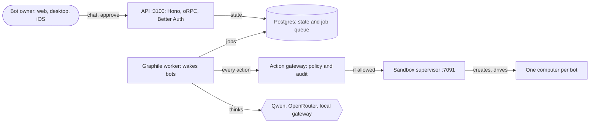

# Kodros Bot

A self-hostable app for AI bots that each keep their own thread, memory, routines and computer. The computer is a Docker container by default, or an E2B sandbox. Web, Electron desktop and Expo iOS clients share one API. Beta, for developers who run it themselves; there is no Kodros-hosted service.

Kodros is the model plus the application plus compute. That is the company, the offer, and the message.

> Fork of [elie222/rakazo](https://github.com/elie222/rakazo) (Apache-2.0), branched at upstream commit `fd445cd`. Upstream is canonical for the original product and has moved on (about 1,100 commits ahead as of 2026-10-10, with features this fork lacks). Upstream `LICENSE`, `NOTICE` and history are kept; provenance is in [UPSTREAM.md](UPSTREAM.md). Issues are disabled here.

## What the fork changes

- Runtime: Nous Research Hermes Agent v0.20.4 is the default (`AGENT_RUNTIME=hermes`), with in-tree Bot Mode (named roster, routines, bot-to-bot). Vendored Hermes code is MIT.
- Action gateway: `packages/gateway` checks a fail-closed policy and writes an `action_audits` row before a bot acts.
- Models: Qwen (DashScope or any OpenAI-compatible API) by default, plus a `MESHBOT_GATEWAY_*` lane for a self-hosted endpoint. OpenRouter and the rest of the Pi catalog still work.
- Computers: a `desktop` provider ("This Mac"), owner approvals for tool effects, and Rust viewer code in `native/meshbot-viewer-core`.
- Release: signed and notarized macOS build script and an iOS production preflight.

## How it works



Each bot has one thread, one computer, memory, routines and history. A bot can spawn peer bots, message another bot, or run short subagents inside a turn.

## Stack

TypeScript, React 19, Vite, Tailwind, Electron, Expo, Hono, oRPC, Postgres, Prisma, Better Auth, Graphile Worker, Pi, Docker or E2B, Composio.

## Run locally (web)

Needs Node.js 22+, pnpm 9 and Docker.

```bash
cp .env.example .env    # set BETTER_AUTH_SECRET, ENCRYPTION_KEY, and a model key (or add one at onboarding)
docker compose -f infra/compose/docker-compose.yml up postgres -d
pnpm install && pnpm db:generate && pnpm db:migrate && pnpm sandbox:build
pnpm dev                # API :3100, worker, web :5173, sandbox supervisor :7091
curl -s http://127.0.0.1:3100/health   # expect "runtime":"hermes","sandbox":"docker","wakeup":"graphile"
```

Open http://127.0.0.1:5173, sign up, pick a model, create a bot and send a message. The computer pane is a live Linux desktop with a browser; take control to sign in, and the bot keeps the session.

| `SANDBOX_PROVIDER` | Where commands run | Use it for |
| --- | --- | --- |
| `docker` (default) | A container per bot on your machine | Trusted single-machine self-hosting |
| `e2b` | A remote E2B sandbox (`E2B_API_KEY`) | Public or multi-user deployments |
| `desktop` | Directly on the host as your user | A trusted single-user machine only |
| `fake` | In-process emulator | Tests |

Desktop app, Bot Mode, packaged installers, signed macOS release and the iOS build: [docs/CLIENTS.md](docs/CLIENTS.md). Self-hosting: [docs/self-host.md](docs/self-host.md).

## Test

```bash
pnpm verify:fast       # unit, property and contract tests, no live models
pnpm verify            # Postgres via Testcontainers, API, Playwright
```

## Status

Version 0.1.0, beta (see [PRODUCT.md](PRODUCT.md) and [CHANGELOG.md](CHANGELOG.md)). Package scope is `@meshbot/*`. Unsigned CI builds are smoke-test artifacts only.

More detail: [docs/ARCHITECTURE.md](docs/ARCHITECTURE.md).

## License

Apache-2.0, inherited from Rakazo ([LICENSE](LICENSE)). Vendored Hermes Agent code is MIT ([NOTICE](NOTICE)). Contact: [tanner@kodros.ai](mailto:tanner@kodros.ai). Security reports: [SECURITY.md](SECURITY.md).
